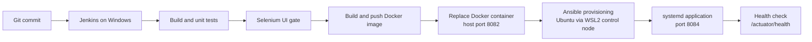

# Crop Advisory Portal

A web portal where farmers raise crop queries, agricultural experts give advice, and admins monitor progress. The project is also a demonstration of a full DevOps lifecycle.

## Features (MVP)
- Create, view, update and search advisory records
- Role-based status workflow: Submitted, Under Review, Advised, Closed
- Summary dashboard (totals, status-wise and crop-wise counts)
- Login with roles: Farmer, Expert, Admin

## Tech stack
Java 17, Spring Boot 3.5 (WAR), Thymeleaf, Spring Security, Spring Data JPA, H2, Maven, Tomcat 10.1

## Architecture



Jenkins currently builds, tests, pushes to the local registry, and deploys Docker. The Ansible deployment is a separately invoked post-pipeline step, not a Jenkins stage. See [docs/ARCHITECTURE.md](docs/ARCHITECTURE.md) for component and deployment diagrams.

## Ports
| Service | Port |
|---|---|
| Jenkins (Windows service) | 8080 |
| Tomcat 10.1 (external WAR deployment) | 8081 |
| Docker host port (container listens on 8080) | 8082 |
| Local development (`mvn spring-boot:run`) | 8083 |
| Ansible-managed Ubuntu service | 8084 |
| Jenkins UI-test application (temporary) | 8085 |

## Getting started
1. Install JDK 17, Maven 3.9 and Git.
2. Clone the repository and open the project folder.
3. Build and test: `mvn clean package`
4. Run: `mvn spring-boot:run`
5. Open http://localhost:8083/login
6. Health check: http://localhost:8083/actuator/health

## Running the project stages

Run commands from the repository root unless noted. The full pipeline needs Windows Jenkins with Git, Maven 3.9, Java 17+, headless Chrome, Docker Desktop in Linux-container mode, and the Jenkins test credentials described below.

1. **Build and unit tests:** `mvn -B clean package`. This creates `target/crop-advisory.war`; it does not launch Chrome.
2. **Selenium UI tests:** ensure Chrome is installed and the test accounts are configured as the three Jenkins credentials. For local runs, set the six `UI_*` environment variables and `APP_PORT=8085` as shown in the Selenium section below; the Maven profile starts and stops its own test application. Jenkins uses the same profile on port 8085 with an isolated workspace database.
3. **Tomcat deployment (optional):** copy `target/crop-advisory.war` to Tomcat 10.1 `webapps` and browse to `http://localhost:8081/crop-advisory/login`. Task 8's separate Jenkins script requires a Tomcat Manager credential.
4. **Docker deployment:** after a successful package, run `docker build -t crop-advisory:1.0.0 .`, then `docker run -d --name crop-advisory -p 8082:8080 -v crop-advisory-data:/data crop-advisory:1.0.0`. The Jenkins pipeline performs a unique-tagged image build/push to the local registry and replaces the container only after tests pass.
5. **Ansible deployment:** from the Ubuntu WSL2 control node, build a WAR readable there, then in `ansible/` run `ansible-playbook site.yml -e app_version=1.0.0 -e war_path=/path/to/crop-advisory.war`. Verify `curl -fsS http://localhost:8084/actuator/health`; the playbook validates JSON `status: UP` and rolls back an unhealthy release.

Jenkins' pipeline pushes to a local registry at `localhost:5000`. Configure credentials and service-account access before using it; do not commit credentials. See [docs/TROUBLESHOOTING.md](docs/TROUBLESHOOTING.md) for Windows Jenkins, Tomcat, Docker Desktop, and WSL Ansible guidance. Known gaps and proposed follow-ups are in [docs/LIMITATIONS.md](docs/LIMITATIONS.md) and [docs/FUTURE_ENHANCEMENTS.md](docs/FUTURE_ENHANCEMENTS.md).

## Selenium UI tests

Install Google Chrome before running the browser tests. The Maven `ui-tests` profile starts and stops the application itself; it defaults to port 8083. In PowerShell, choose a temporary database path and set environment variables for the UI test accounts (do not put credentials in source control), then run the Selenium/JUnit journeys:

```powershell
$env:UI_FARMER_USERNAME = "<farmer username>"
$env:UI_FARMER_PASSWORD = "<farmer password>"
$env:UI_EXPERT_USERNAME = "<expert username>"
$env:UI_EXPERT_PASSWORD = "<expert password>"
$env:UI_ADMIN_USERNAME = "<admin username>"
$env:UI_ADMIN_PASSWORD = "<admin password>"
$env:APP_PORT = "8085"
$env:DB_PATH = "$PWD\target\ui-test-data\local-cropdb"
mvn -B verify -Pui-tests "-Dbase.url=http://localhost:8085"
```

Selenium is included with test scope, and the `ui-tests` profile runs `*IT.java` tests through Maven Failsafe. The default `mvn clean package` build does not launch a browser. Chrome runs headlessly, and Selenium Manager resolves the matching WebDriver. If a UI test fails, its browser screenshot is saved under `target/screenshots`; Failsafe reports are written to `target/failsafe-reports`. Jenkins runs the test application on port 8085 with its own workspace database.

## Docker Desktop (Windows, Linux containers)
Build the WAR before building the image. From the repository root in PowerShell:

```powershell
mvn clean package
docker build -t crop-advisory:1.0.0 .
docker images crop-advisory
docker volume create crop-advisory-data
docker run -d --name crop-advisory -p 8082:8080 -v crop-advisory-data:/data crop-advisory:1.0.0
docker ps
```

The portal is available at http://localhost:8082/login. Port 8082 is used on the host because Jenkins already occupies host port 8080; Docker forwards host port 8082 to the application’s container port 8080. The application stores its H2 database in `/data`, persisted in the named `crop-advisory-data` volume.

Useful container lifecycle commands:

```powershell
# Follow application output; press Ctrl+C to stop following (the container keeps running).
docker logs -f crop-advisory

# Open a shell in the running container; type exit to leave.
docker exec -it crop-advisory bash

# Show the configured image, ports, environment, mount and health status.
docker inspect crop-advisory --format 'Image={{.Config.Image}} Ports={{json .NetworkSettings.Ports}} Env={{json .Config.Env}} Mounts={{json .Mounts}} Health={{json .State.Health}}'

docker stop crop-advisory
docker ps
docker ps -a
docker start crop-advisory
docker ps
docker restart crop-advisory
docker ps
docker stop crop-advisory
docker rm crop-advisory
docker ps -a
docker rmi crop-advisory:1.0.0
```

`docker ps` lists running containers only; after `docker stop`, use `docker ps -a` to see the stopped container. Remove the named data volume only when its database should also be deleted: `docker volume rm crop-advisory-data`.

## Jenkins CI (Windows)
The Freestyle job `crop-advisory-ci` builds the `develop` branch from GitHub. Configure Jenkins to poll SCM with `H/5 * * * *`; polling is used because a Jenkins instance running locally is not reachable by GitHub webhooks.

## Jenkins Pipeline and Docker deployment (Windows)

Keep the existing Freestyle job `crop-advisory-ci` and its build history. Create a separate Jenkins **Pipeline** job (for example, `crop-advisory-pipeline`) using **Pipeline script from SCM**:

1. Set **SCM** to Git, enter the repository URL, and set **Branches to build** to `*/release/1.0.0` to validate this release, then `*/develop` after merge.
2. Set **Script Path** to `Jenkinsfile` and enable **Poll SCM** with `H/5 * * * *` if webhooks cannot reach the Jenkins instance.
3. Save and run the job. It builds and tests, runs Selenium, builds and pushes commit-tagged Docker images, then deploys only after all earlier stages pass.

The UI Tests stage runs Chrome headlessly as the Jenkins service account. Install Chrome for that account and create three Jenkins **Username with password** credentials with IDs `ui-test-farmer`, `ui-test-expert`, and `ui-test-admin`, each for the corresponding local test account. These values are injected only during the test stage. The Maven `ui-tests` profile starts the application in `pre-integration-test` on port 8085 and stops it in `post-integration-test`; `DB_PATH` points to a temporary H2 file under the workspace. The post action publishes Surefire and Failsafe XML reports and archives any `target/screenshots` failure images.

In **Manage Jenkins > Tools**, configure JDK 17 (or a compatible newer JDK) and Maven 3.9. Ensure Git, Maven, and Docker CLI are on the system `Path` and accessible to the Jenkins Windows service account.

### Local registry setup

This pipeline uses a local registry at `localhost:5000`, so it does not require Docker Hub credentials. Start it once on the Docker host before the first pipeline run:

```powershell
docker run -d --name crop-registry --restart unless-stopped -p 5000:5000 registry:2
docker ps --filter name=crop-registry
curl.exe http://localhost:5000/v2/_catalog
```

The image is tagged `localhost:5000/crop-advisory:<BUILD_NUMBER>-<7-character-GIT_COMMIT>` and `latest`; Docker Deploy uses the unique commit tag. Docker Hub can be used instead by adding a Jenkins Username with password credential with ID `dockerhub`, logging in with `docker login --password-stdin`, and using `<DOCKERHUB_USER>/crop-advisory` as the image repository.

### Windows Jenkins service Docker access

Docker commands execute under the Jenkins Windows service identity. Configure Jenkins to run as a dedicated Windows account supported by Docker Desktop, add that same account to the local `docker-users` group from an elevated PowerShell prompt, then restart Jenkins:

```powershell
Add-LocalGroupMember -Group 'docker-users' -Member '.\jenkins'
Restart-Service Jenkins
```

Replace `.\jenkins` with the account shown under **Services > Jenkins > Properties > Log On**. If changing the service identity, grant it **Log on as a service** and the minimum necessary workspace access. Ensure Docker Desktop is running Linux containers. The `docker-users` group grants access to Docker Desktop's privileged named pipe; it does not start Docker Desktop. For a Jenkins service running as `LocalSystem`, use a service account supported by the Docker Desktop installation rather than blindly adding `LocalSystem` to the group.

Docker deployment replaces the Tomcat deploy stage in this pipeline: deploying the same application to both targets would be redundant and require extra Tomcat credentials and service permissions. Tomcat 10.1 on port 8081 remains available for separate manual deployments; Docker uses host port 8082 because Jenkins already occupies 8080.

### Legacy Task 8 Tomcat Jenkins deployment

The earlier Task 8 pipeline used Tomcat Manager. To continue using that separate deployment flow, create a Jenkins Username with password credential with ID `tomcat-manager`. Do not put its username or password in the Jenkinsfile, repository, or command-line parameters.

Set `CATALINA_BASE` in the Jenkins agent/service environment to the Tomcat base directory. The configured Tomcat 10.1.61 installation is `C:\apache-tomcat-10.1.61`; the deploy script uses this path and the Windows service name `Tomcat10` as defaults when they are not overridden. Configure its HTTP connector to use port 8081 (Jenkins uses 8080), then install the Windows service from an elevated command prompt with `C:\apache-tomcat-10.1.61\bin\service.bat install Tomcat10`. The Jenkins Windows service account needs access to the JDK, Maven, Git, workspace and Maven cache, permission to write those Tomcat/data paths, and permission to stop and start the Tomcat Windows service. Grant only the necessary rights; an administrator may need to install/configure the service and grant service-control permissions.

**Windows service caveat:** `setenv.bat` is normally consumed by Tomcat's startup scripts, but a Tomcat Windows service installed through the service wrapper (Procrun) may not read it. Verify how the service starts Tomcat. If it does not consume `setenv.bat`, configure `APP_ENV` and `DB_PATH` as Java options/environment for that service using its supported service configuration, and ensure the Jenkins account can update the selected environment settings. The script's file creation alone does not guarantee that the running service will inherit them.

### Tomcat Manager setup

In Tomcat's `%CATALINA_BASE%\conf\tomcat-users.xml`, define a dedicated deployment user with only the `manager-script` role. Replace both placeholder values with a unique username and a strong, non-reused secret; the values below are examples, not working credentials:

```xml
<role rolename="manager-script"/>
<user username="jenkins-deploy" password="REPLACE_WITH_A_STRONG_SECRET" roles="manager-script"/>
```

In the Manager application's `META-INF\context.xml` (commonly `%CATALINA_BASE%\webapps\manager\META-INF\context.xml`), retain a `RemoteAddrValve` that permits loopback addresses only so the text API remains local to the Jenkins/Tomcat host:

```xml
<Valve className="org.apache.catalina.valves.RemoteAddrValve"
       allow="127\.\d+\.\d+\.\d+|::1|0:0:0:0:0:0:0:1" />
```

Do not expose the Manager text API to remote hosts. Restart Tomcat after changing its Manager configuration. The Task 8 deploy script deploys `target\crop-advisory.war` through `http://localhost:8081/manager/text/` and performs a bounded health check against `http://localhost:8081/crop-advisory/actuator/health`.

For Task 8 delivery evidence, capture the Jenkins Pipeline job's SCM/script-path configuration and a successful Tomcat deployment/health-check result. Redact usernames, credentials, tokens, and other secrets from screenshots or logs; never include the actual `tomcat-users.xml` secret.

## Deploy on Tomcat 10.1 (port 8081)
Copy `target/crop-advisory.war` into `<TOMCAT_HOME>/webapps/` and open http://localhost:8081/crop-advisory/login

## Configuration (environment variables)
| Variable | Default | Purpose |
|---|---|---|
| APP_PORT | 8083 | Port for `mvn spring-boot:run` |
| APP_ENV | dev | Environment label shown on the home page |
| DB_PATH | ./data/cropdb | H2 database file location |

## Ansible deployment (WSL2 control node)

Ansible's control node requires Linux; run it from Ubuntu on WSL2, not from Windows. Install Ubuntu 24.04 (or 22.04) from Windows PowerShell if it is not already available:

```powershell
wsl.exe --install -d Ubuntu-24.04
```

The managed host must be a second Ubuntu 22.04/24.04 WSL2 distro or a Linux VM with SSH and systemd. Enable systemd in `/etc/wsl.conf` on each WSL distro that needs it:

```ini
[boot]
systemd=true
```

After editing the file, run `wsl.exe --shutdown` in Windows PowerShell and reopen the distros. Install Ansible and the build prerequisites in the control distro:

```bash
sudo apt update
sudo apt install -y ansible openjdk-17-jdk maven
```

Check `mvn -version` before packaging: Ubuntu's repository may provide a Maven release older than the project's Maven 3.9 requirement. Use Maven 3.9 for the WAR build.

On the target, install and enable SSH, and ensure the SSH account can use `sudo`:

```bash
sudo apt update
sudo apt install -y openssh-server
sudo systemctl enable --now ssh
hostname -I
```

Configure SSH key authentication or use Ansible's password prompts. Do not commit private keys or passwords. Clone the project inside the control distro's Linux filesystem, build and test the WAR, and enter the Ansible directory:

```bash
mvn -B clean package
cd ansible
```

Set the target host address and SSH user in `inventory/hosts.ini`. This branch's entry points to the local WSL test target; WSL addresses may change, so refresh it with `hostname -I` on the target after WSL restarts. A VM with a stable address is preferable. The inventory group is `crop_servers`.

```bash
ansible --version
ansible-inventory --list
ansible all -m ping
ansible-playbook site.yml --syntax-check
ansible-playbook site.yml --check --diff
ansible-playbook site.yml
```

The local disposable WSL target uses key-only SSH and passwordless sudo for the `ansible` account. For a regular target, configure SSH and sudo securely, and add `--ask-become-pass` to check and deployment runs when sudo requires a password. Do not use passwordless sudo as a general production recommendation.

The playbook installs Java 17 and curl, installs the WAR under `/opt/crop-advisory/releases/<version>/`, and starts `crop-advisory.service` on port 8084. It persists H2 data in `/var/lib/crop-advisory/data`. The UFW rule is added only when UFW is installed and active. Once deployed, verify on the target with `systemctl status crop-advisory` and `curl http://localhost:8084/actuator/health`. See [docs/CONFIG_SPEC.md](docs/CONFIG_SPEC.md) for the managed configuration inventory.

### Ansible release deployment, health rollback, and manual rollback

The `deploy` role accepts `war_path` as a path readable on the Ansible control node (for Jenkins, pass the workspace artifact path), stores it in an immutable versioned release, switches `current`, restarts only when the WAR, link, or service configuration changed, and waits for `/actuator/health` up to 10 times with a 5-second delay. Health is accepted only for an HTTP 200 response containing JSON `{"status":"UP"}`; redirects are not followed. A failed deployment restores the prior release and verifies its health before returning a clear failed-play message. Use a new `app_version` for changed WAR content; overwriting the currently active release with different bytes is refused because it would make rollback unsafe. After a successful deploy or manual rollback, only the active release and the two most recently modified previous releases are retained.

From the Ansible directory, deploy a Jenkins workspace artifact using its control-node-visible path:

```bash
ansible-playbook site.yml \
  -e "war_path=${WORKSPACE}/target/crop-advisory.war" \
  -e "app_version=${BUILD_NUMBER}"
```

For a Windows Jenkins workspace accessed by WSL Ansible, translate the workspace path to its mounted Linux path (for example `/mnt/c/ProgramData/Jenkins/.jenkins/workspace/crop-advisory-pipeline/target/crop-advisory.war`). `war_path` must refer to a file on the Ansible control node; Ansible copies it to the target. To rerun provisioning unchanged, use the same WAR and `app_version`; the recap should show `changed=0`.

To manually activate an installed release, specify its directory name:

```bash
ansible-playbook rollback.yml -e rollback_to=123
```

The rollback play verifies the selected WAR before changing `current`, restarts the service, waits for health, prunes releases to the configured limit, and restores the previously active link if the selected release does not pass health.

For a failure-path demonstration, create a disposable source copy or throwaway branch, remove `health` from `management.endpoints.web.exposure.include` in that copy, run `mvn -B clean package`, and deploy that WAR with a new `app_version`. The application will start but its health URL will fail the strict check (for example, by returning 404 or redirecting to login); the play should fail after restoring the working `current` release. Do not introduce the deliberate defect on a shared branch or overwrite the known-good WAR.

To reset a WSL target, first create or retain a clean pre-provisioning backup/snapshot. `wsl.exe --unregister Ubuntu-22.04` permanently deletes that distro and its database/data; only run it when that exact target is disposable and you have the intended clean rootfs archive to re-import:

```powershell
wsl.exe --export Ubuntu-22.04 C:\WSL\Ubuntu-22.04-clean.tar
wsl.exe --unregister Ubuntu-22.04
wsl.exe --import Ubuntu-22.04 C:\WSL\Ubuntu-22.04 C:\WSL\Ubuntu-22.04-clean.tar --version 2
```

The export must be a pre-provisioning baseline to produce a clean target. Otherwise, prefer restoring a VM snapshot or install a fresh disposable WSL distro with `wsl.exe --install -d Ubuntu-22.04`. Never unregister a distro containing data you need.

## Branching
See docs/BRANCH_POLICY.md. Work happens on feature branches, merged into develop through pull requests. The main branch holds tagged, release-ready code.

## Demo users (dummy data only)
| Username | Password | Role |
|---|---|---|
| farmer1 | Farmer@123 | Farmer |
| expert1 | Expert@123 | Expert |
| admin1 | Admin@123 | Admin |

## Project status
Work is tracked through GitHub Issues and milestones.

## Troubleshooting

- **Windows Jenkins:** run Windows batch steps with `bat`; confirm the Jenkins service identity can access Git, Maven, Java, Chrome, the workspace, and Docker Desktop's named pipe. See the [Jenkins troubleshooting guide](docs/TROUBLESHOOTING.md#windows-jenkins).
- **Tomcat:** use Tomcat 10.1 with the WAR at `webapps/crop-advisory.war`; check the context path, Manager loopback restriction, and Tomcat logs. See the [Tomcat troubleshooting guide](docs/TROUBLESHOOTING.md#tomcat-101).
- **Docker Desktop:** use Linux containers, start Docker Desktop, confirm `docker info`, and ensure ports 8080/8082/5000 are not occupied by conflicting services. See [Docker troubleshooting](docs/TROUBLESHOOTING.md#docker-desktop).
- **WSL Ansible:** run Ansible inside the Ubuntu control distro (not PowerShell), refresh dynamic WSL target addresses, and check SSH, systemd, and sudo. See [WSL Ansible troubleshooting](docs/TROUBLESHOOTING.md#wsl2-ansible).
