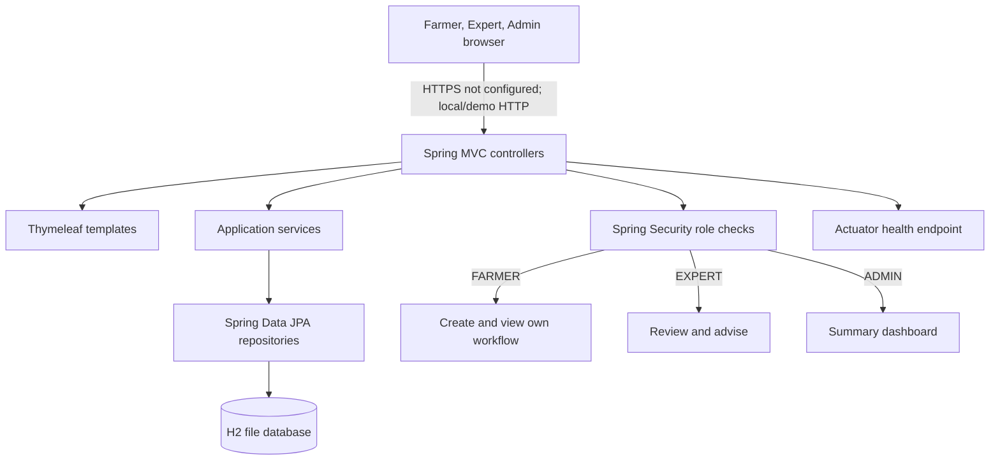

# Crop Advisory Portal Architecture

## Release and deployment flow

```mermaid
flowchart LR
    Dev[Developer] -->|commit and push| Git[GitHub repository]
    Git -->|SCM checkout| CI[Jenkins on Windows]
    CI --> Build[Build WAR and unit tests]
    Build -->|pass| UI[Selenium UI tests<br/>Chrome headless]
    UI -->|pass| Image[Build commit-tagged image]
    Image --> Registry[Local Docker registry<br/>localhost:5000]
    Registry --> Deploy[Replace Docker container]
    Deploy --> DockerApp[Docker app<br/>host port 8082]
    DockerApp -->|post-pipeline deploy| Control[Ansible control node<br/>Ubuntu on WSL2]
    Control -->|SSH and idempotent playbook| Target[Ubuntu 22.04/24.04<br/>systemd service on 8084]
    Target --> Health[GET /actuator/health<br/>HTTP 200 and status UP]
    Health -->|failure| Rollback[Restore prior immutable release]
    Rollback --> Target
```

The `Jenkinsfile` currently gates Docker deployment on build/unit and Selenium success, pushes a commit-specific tag plus `latest` to a local registry, and replaces the Docker container on host port 8082. Ansible is a separately invoked deployment after the Jenkins pipeline; it is not a Jenkins stage and requires a Linux control node. Ansible installs and runs the same WAR on the separate Ubuntu target at port 8084.

## Application components

The application is a Java 17 executable WAR built with Spring Boot 3.5 and Maven. It uses Thymeleaf for server-rendered pages, Spring Security for role-based access, Spring Data JPA and H2 for persistence, and Actuator for the public health endpoint. The workflow states are Submitted, Under Review, Advised, and Closed. Existing HTML IDs are part of the Selenium selector contract and should be preserved.

## Ports

| Component | Port | Role |
|---|---:|---|
| Jenkins Windows service | 8080 | CI orchestration |
| External Tomcat 10.1 | 8081 | Optional WAR deployment |
| Docker host | 8082 | Maps to container port 8080 |
| Local Spring Boot development | 8083 | `mvn spring-boot:run` default |
| Ansible-managed Ubuntu systemd service | 8084 | Separate Linux deployment |
| Jenkins UI-test application | 8085 | Temporary Maven Failsafe application |
| Local Docker registry | 5000 | Image push/pull for the pipeline |
